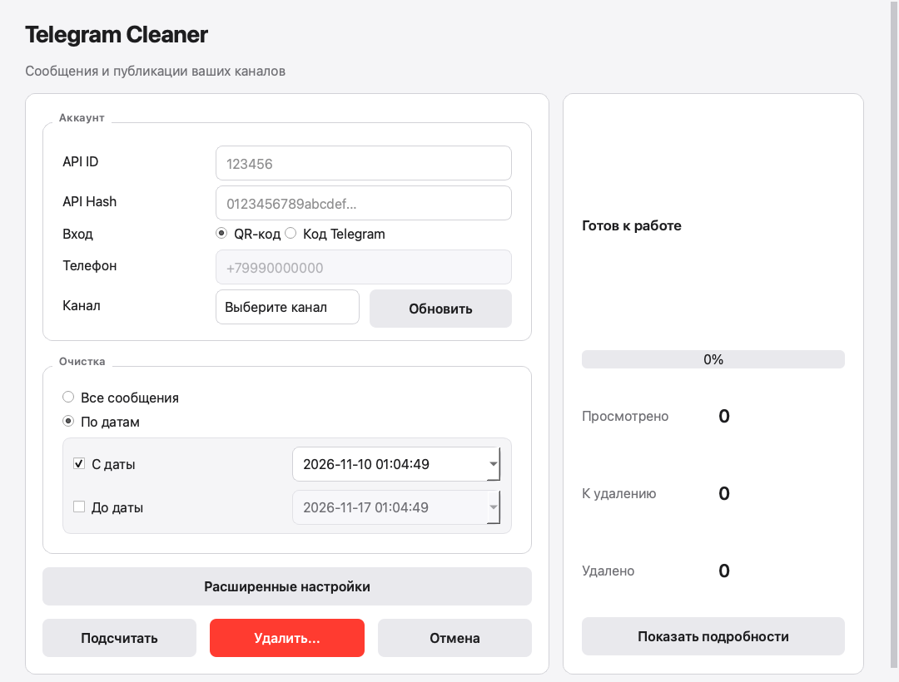

# Telegram Cleaner

Управление сообщениями в Telegram-каналах и супергруппах: выбор периода, подсчёт и удаление с подтверждением.

Автор: [Марк / MDRK Studio](https://mdrkstudio.ru).



## Возможности

- Вход по QR-коду или коду Telegram, поддержка 2FA.
- Список каналов и супергрупп, которыми вы управляете.
- Все сообщения или выбранный период, фильтр собственных сообщений и лимит.
- Подсчёт перед удалением и подтверждение с названием и ID канала.
- Обработка только отобранного списка сообщений.
- Отмена операции, прогресс и паузы при ограничениях Telegram.

## Установка

Python 3.11+:

```bash
git clone https://github.com/mdrkstudio/telegram-cleaner.git
cd telegram-cleaner
python3 -m venv .venv
source .venv/bin/activate
python -m pip install -r requirements.txt
python delete_posts_gui.py
```

В Windows активация окружения: `.venv\Scripts\activate`. После установки доступна команда `telegram-cleaner`.

Получите свои API ID и API Hash на [my.telegram.org](https://my.telegram.org), заполните поля и нажмите «Обновить». Для QR-входа откройте Telegram на телефоне: «Настройки > Устройства > Подключить устройство».

## Работа с сообщениями

1. Выберите канал.
2. Укажите период или «Все сообщения».
3. Нажмите «Подсчитать», чтобы увидеть количество.
4. Нажмите «Удалить...». Приложение заново сформирует список и покажет название канала, ID, период и количество.
5. Введите показанный ID и подтвердите удаление для всех.

Удалённые сообщения восстановить через приложение нельзя. Даты задаются во времени компьютера, обе границы включаются. Одна операция удаления ограничена 100 000 сообщений; для большей истории используйте даты и лимит.

В расширенных настройках доступны собственные сообщения, размер пачки, таймауты и паузы. При отмене уже обработанные пачки остаются удалёнными.

Для работы только с подсчётом:

```bash
telegram-cleaner --dry-run
```

## Данные и настройки

API Hash вводится при запуске или берётся из `TELEGRAM_API_HASH`. В файле настроек он не сохраняется. API ID можно задать через `TELEGRAM_API_ID`. Коды входа и пароль 2FA используются только для авторизации.

Сессия и настройки хранятся в системной папке `MDRKTelegramCleaner`. Своя папка:

```bash
telegram-cleaner --data-dir ./cleaner-data
```

Содержимое сессии предоставляет доступ к аккаунту: храните его у себя. В Git исключены сессии, настройки, базы и логи. Приложение отправляет запросы напрямую Telegram через Telethon.

## Лицензия

Авторский код - [PolyForm Noncommercial 1.0.0](LICENSE). Некоммерческое использование, изменения и распространение разрешены по её условиям. Сохраняйте LICENSE и [NOTICE](NOTICE).

Для коммерческого применения нужно разрешение [MDRK Studio](https://mdrkstudio.ru/contacts). Сторонние зависимости сохраняют собственные лицензии. Интерфейс использует PySide6/Qt (LGPL v3); сведения о зависимостях приведены в [THIRD_PARTY.md](THIRD_PARTY.md).
